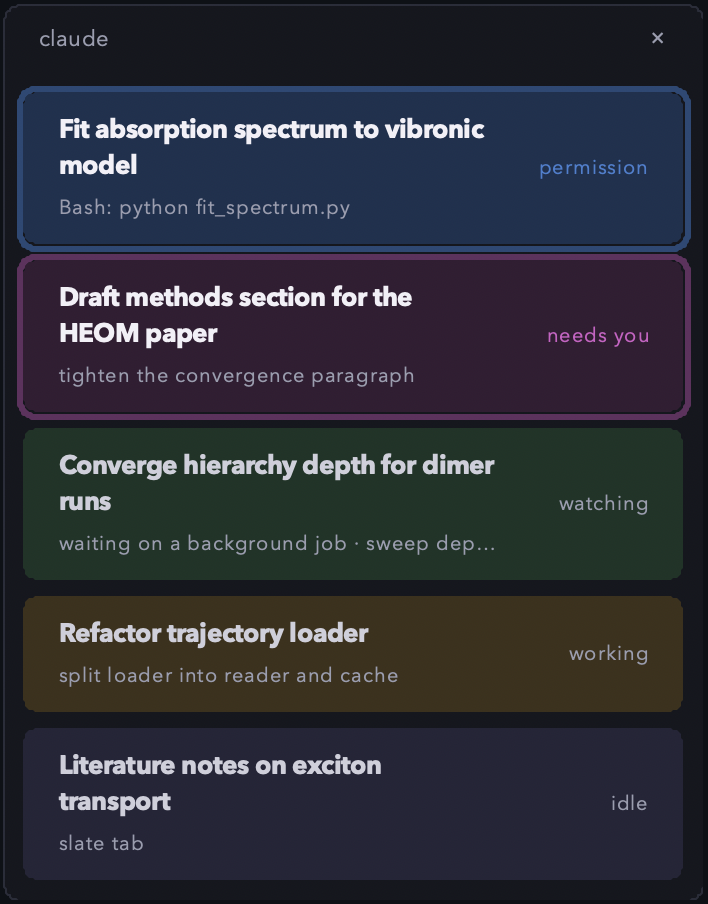
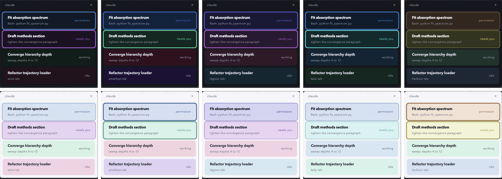

# Claude session widget

**A small always-on-top panel that shows every Claude Code session you have open, and which ones need you.**

If you run several Claude Code sessions in different Terminal tabs, it is easy to lose track of the one quietly waiting for an answer. This panel sits in the corner of your screen, lists each session with a short summary of what it is doing, and pulses the ones that are waiting on you. Click a card to jump straight to that tab.

Each Claude tab also gets its own background colour, and its card in the panel matches. Pick from eighteen colour schemes, each in a light and a dark version.

<p align="center">
  
</p>

---

## Contents

- [What it shows](#what-it-shows)
- [Requirements](#requirements)
- [Install](#install)
- [Using the panel](#using-the-panel)
- [Tab colours](#tab-colours)
- [Commands](#commands)
- [How it works](#how-it-works)
- [Configuration](#configuration)
- [Troubleshooting](#troubleshooting)
- [Updating and uninstalling](#updating-and-uninstalling)
- [Privacy](#privacy)
- [Development](#development)
- [License and contact](#license-and-contact)

---

## What it shows

Each card is one Claude Code session.

- **The title** is a short summary, always on one line, of what the session is working on now, refreshed after each reply. Before the first summary, it is the name Claude Code gives the chat, or else the folder name.
- **The second line** is where and what now. It starts with the project, in the card's colour: the git checkout the session is working in, or else its folder. While Claude works, it adds the step Claude is on, such as "Editing loader.py". While Claude watches a background job, it says "your turn" and what it is waiting on, such as "your turn · waiting on a background job". You can reply, and Claude also resumes on its own when the job ends. When it is only your turn, it shows just the project.
- **The summary** in the title is written by a small model (Haiku, through your own `claude` command) from your last few prompts. Turn it off with `/widget summary off`.
- **A third line appears while subagents run.** It counts them and lists what each one is doing. Background agents stay listed until they finish.
- **Hover over a card** to see its full title, the chat's original name, the folder, each running agent, and that session's prompts and working time today.
- **Hover over the "claude" header** to see today's stats: prompts sent, how long Claude worked, the longest unbroken stretch, and the busiest session.
- **A small pet sits beside each status.** Pick one of three quantum starters. **cat** is Schrodinger's cat: asleep in its shut box when idle, peeking over the rim while it watches, popping out when it needs you. **photon** is a little star of light whose rays turn while Claude works. **qubit** sits on its Bloch sphere, its state arrow precessing while Claude works, pointing up when it needs you and resting down asleep. Each takes the card's colour. Choose with `/session-widget:widget pet qubit`, or hide it with `pet off`.
- **The pill on the right** is the session's status. Under it is how long the session has been in that status, so you can see which one has waited longest.

| Status | Meaning | Card |
| --- | --- | --- |
| **permission** | Claude wants you to approve a tool call. | Pulses, with a macOS banner |
| **needs you** | Claude finished its turn and is waiting for your reply. | Pulses, with a macOS banner |
| **working** | Claude is busy on your last prompt. | Steady |
| **watching** | Claude is waiting on something it started, in this turn or an earlier one: a background job, a subagent, a timer or a watcher. You can still reply. | Steady |
| **idle** | Nothing is happening in this session. | Steady |

Sessions that need you always sort to the top.

**Mute banners for a while.** Click "mute banners" at the top of the panel to silence macOS banners for an hour, and click again to turn them back on. Cards still pulse. For another length, run `/widget mute 20`, or `/widget unmute`.

**Updates take effect on their own.** After `claude plugin update`, the panel notices the new version within half a minute and restarts onto it.

**Statuses stay right even when a hook is missed.** Claude Code animates a symbol at the start of the Terminal tab title while it works, and shows a star while it waits. The panel reads the tab titles every second or two and corrects a card that disagrees, for example after you press Escape. It never hides a permission prompt.

---

## Requirements

- **macOS.** The panel, banners and tab switching all use macOS features.
- **Apple's Terminal app** for click-to-jump. The panel works with other terminals, but clicking a card only switches tabs in Terminal.
- **Claude Code** with plugin support.
- **`python3` on your `PATH`, with Tkinter.** Anaconda, Miniconda and the python.org installer all include Tkinter. Check yours with:

```bash
python3 -c "import tkinter; print('tkinter ok')"
```

If that prints an error, install Python from [python.org](https://www.python.org/downloads/macos/) or use a conda Python. Homebrew users can run `brew install python-tk`.

No other packages are needed. The widget uses only the Python standard library.

---

## Install

Inside any Claude Code session, run these two commands:

```text
/plugin marketplace add alexiahartzell/claude-session-widget
/plugin install session-widget@session-widget
```

Then **quit and start a new Claude Code session.** The panel appears in the bottom-right corner of your screen.

**The first time the panel talks to Terminal**, macOS asks whether Python may control Terminal. Click **OK**. Click-to-jump and the status check from tab titles both need it.

Prefer the terminal? The same install works from your shell:

```bash
claude plugin marketplace add alexiahartzell/claude-session-widget
claude plugin install session-widget@session-widget
```

---

## Using the panel

- **It starts by itself** when any Claude Code session starts. There is nothing to launch.
- **Click a card** to bring its Terminal tab to the front.
- **Drag anywhere on the panel** to move it. It remembers where you put it.
- **Click ×** to hide the panel. It comes back on its own as soon as a session needs you.
- **It hides itself** about thirty seconds after your last session closes.

Only one panel ever runs, however many sessions you open.

---

## Tab colours

Every Terminal tab running Claude Code gets its own background colour when the session starts. No two open tabs share a colour, and each card in the panel matches its tab. When the session ends, the tab goes back to its original colours.

There are eighteen colour schemes, and each comes in a dark and a light version. Light mode also turns the tab's text dark and gives the panel a light background, so it works whatever your Terminal profile looks like.

<p align="center">
  
</p>
<p align="center"><sub>Each scheme in its dark version, then its light version, with colours in rainbow order so schemes are easy to compare.</sub></p>

### Colour schemes

| Scheme | Colours | Feel |
| --- | --- | --- |
| **muted** | 10 | Soft, greyish colours from every part of the rainbow. The default. |
| **jewel** | 10 | Deep, rich colours from every part of the rainbow. |
| **colourblind** | 10 | Colours picked to stay distinct for protanopia, deuteranopia and tritanopia. |
| **dusk** | 10 | Only purples, lilacs, mauves and dusty roses. |
| **berry** | 10 | Only berry colours: blues, purples, magentas and reds. |
| **galaxy** | 10 | Only deep night-sky blues and violets. |
| **neon** | 10 | Only bright synthwave colours: cyans, blues, violets and pinks. |
| **nordic** | 10 | Only cool greys with a hint of blue or green. |
| **ocean** | 10 | Only sea greens, teals and blues, from shallows to the deep. |
| **aurora** | 10 | Only northern-lights colours: greens, teals, blues and violets. |
| **green** | 10 | Only greens, from olive and lime through emerald to sea green. |
| **forest** | 10 | Only greens and woody browns. |
| **desert** | 10 | Only soft earth colours: sand, clay, terracotta and sage. |
| **autumn** | 10 | Only autumn leaves: maroon, rust, pumpkin, ochre and olive. |
| **ember** | 10 | Only fire colours: reds, oranges and golds. |
| **tropical** | 10 | Only tropical colours: pinks, corals, mangos and lagoon blues. |
| **dracula** | 10 | The Dracula palette from the JetBrains Dracula theme, darkened for tab backgrounds. |
| **crewtractor** | 10 | Farm colours named after the crew tractor meme, such as "state property" and "this ain't no". |

**Every scheme has ten colours**, so ten tabs can be open before any colour repeats.

**Each themed scheme stays inside its own colours.** Ocean is only blues and teals, ember only reds and oranges, nordic only cool greys. Cards in a scheme are told apart by lightness and strength as well as hue, because cards and outlines keep each tab colour's own saturation and depth. Muted, jewel and colourblind span the whole rainbow for the most contrast. A test checks that every pair of cards in every scheme stays clearly different in both light and dark mode.

**The colourblind scheme was chosen by simulation.** Its colours were picked so that every pair of cards stays as different as possible under simulated protanopia, deuteranopia and tritanopia. A test in the suite checks this, so it stays true if the colours are ever edited.

Switch scheme:

```text
/session-widget:tint scheme dusk
```

### Light and dark

| Mode | What it does |
| --- | --- |
| **auto** | Follows your macOS appearance setting. The default. |
| **dark** | Dark tab backgrounds with light text, and a dark panel. |
| **light** | Pale tab backgrounds with dark text, and a light panel. |

Switch mode:

```text
/session-widget:tint mode light
```

Both commands save your choice and recolour every open Claude tab straight away. Run either with no name to see what is active. In **auto**, the panel follows macOS within a few seconds. Open tabs keep their colour until you next switch, and new tabs use the current mode.

### Recolouring one tab

| Command | What it does |
| --- | --- |
| `/session-widget:tint` | Give this tab a different random colour. |
| `/session-widget:tint set <colour>` | Give this tab a named colour, such as `set sapphire`. Spaces and punctuation are optional, so `set state property` and `set stateproperty` both work. |
| `/session-widget:tint list` | Show the current colours and which tab has each. |
| `/session-widget:tint reset` | Put this tab back to its original colours. |
| `/session-widget:tint all` | Colour every Claude tab that is not coloured yet. |

The panel picks up a new colour within half a second.

### Turning tab colours off

Set this in the environment Claude Code starts from, for example in `~/.zshrc`:

```bash
export CLAUDE_WIDGET_TINT=off
```

New sessions then leave tab colours alone, and their cards are grey. The `/session-widget:tint` command still works if you want a colour on one tab.

Tab colours only work in Apple's Terminal app. Other terminals are left untouched.

---

## Commands

Run these inside any Claude Code session:

| Command | What it does |
| --- | --- |
| `/session-widget:widget show` | Show the panel. |
| `/session-widget:widget hide` | Hide the panel until a session needs you. |
| `/session-widget:widget quit` | Close the panel completely. It restarts with your next session. |
| `/session-widget:widget name <text>` | Give the current session a custom title on its card. |
| `/session-widget:widget name` | Clear the custom title. |
| `/session-widget:widget mute [minutes]` | Silence macOS banners for a while, an hour by default. Cards still pulse. |
| `/session-widget:widget unmute` | Turn banners back on. |
| `/session-widget:widget summary on` or `off` | Turn the one-line conversation summaries on or off. |
| `/session-widget:widget pet cat`, `photon`, `qubit` or `off` | Choose the pet on each card, or hide it. With no name, it lists the three. |

---

## How it works

There are four small Python programs and no background service.

```text
 Claude Code session --hook events--> tint.py --colours--> the Terminal tab
                     --hook events--> session-state.py --writes--> ~/.claude/widget/sessions/<id>.json
                                            |                                    |
                                after a reply v                                  |
                                      summarise.py --summary--> (same file)      |
                                                                                 |
     macOS banner <-- widget.py (the panel) <--reads twice a second -------------+
                          |
                          +--reads every tab title--> Terminal
```

1. **When a session starts, `tint.py` colours its Terminal tab**, and puts the original colours back when it ends.
2. **Claude Code runs `session-state.py` on its hook events.** These are session start and end, each prompt you send, each tool call, each finished turn, permission requests, and each finished subagent.
3. **The hook writes one small status file per session.**
4. **`widget.py` reads those files twice a second** and redraws the panel when anything changes.
5. **When a session starts needing you**, the panel posts a macOS banner and reappears if it was hidden.
6. **After each reply, `summarise.py` writes the card's summary** in the background. It sends your last few prompts to Haiku through your own `claude` command, with hooks turned off so it never triggers itself.
7. **Every second or two, the panel reads each Terminal tab's title.** Claude Code shows a spinner there while it works and a star while it waits, so the panel can correct a card whose hook was missed.

A few details:

- **Sessions you started before installing** appear once you restart them. Older Claude Code versions also kept a list of running sessions, which the panel reads when it exists.
- **Chat names** come from Claude Code's transcript for each session, or from the Terminal tab title when no transcript is found.
- **Subagents** are tracked from each Agent call. A finished subagent does not say which call it was, so the panel removes the oldest matching one.
- **Closed sessions disappear** as soon as their process ends. Anything untouched for twelve hours is cleared too.
- **Scripted runs such as `claude -p`** are ignored, since there is no tab to jump to.
- **Hooks never block Claude.** Each one finishes in a fraction of a second and always exits cleanly, even on an error.

---

## Configuration

### State folder

Status files, logs and the panel position live in `~/.claude/widget/`. To use another folder, set `CLAUDE_WIDGET_HOME` in the environment Claude Code starts from:

```bash
export CLAUDE_WIDGET_HOME="$HOME/.local/state/claude-widget"
```

### Environment variables

| Variable | Default | Effect |
| --- | --- | --- |
| `CLAUDE_WIDGET_HOME` | `~/.claude/widget` | Where status files, logs and the panel position live. |
| `CLAUDE_WIDGET_TINT` | on | Set to `off` to stop new sessions colouring their tab. |
| `CLAUDE_WIDGET_SUMMARY_MODEL` | `haiku` | The model that writes card summaries. |

### Saved settings

`config.json` in the state folder holds two settings that the commands change:

- **`summaries`**, true or false, set by `/session-widget:widget summary on` or `off`.
- **`pet`**, `cat`, `photon`, `qubit`, or false when off, set by `/session-widget:widget pet`.
- **`mute_until`**, the time banners come back, set by the mute commands or a click on "mute banners".

### Where tab colours are stored

Tab colours live in `~/.claude/tint-state/`, one file per tab, plus `scheme.json` for your chosen scheme and mode. Each tab file is named after the tab's device, with `/` replaced by `_`. For example, `_dev_ttys003.json`:

```json
{ "orig": "000000", "orig_text": "f1f1f1", "tint": "0d2547", "name": "sapphire" }
```

- **`orig`** and **`orig_text`** are the tab's own background and text colour, restored when the session ends.
- **`tint`** is the colour in use, as six hex digits.
- **`name`** is the colour's name in its scheme.

---

## Troubleshooting

**Check the logs first.** They are in your state folder:

```bash
cat ~/.claude/widget/widget.log   # the panel
cat ~/.claude/widget/hooks.log    # the hook script
```

**The panel never appears.**

- Check that `python3` has Tkinter, using the command under [Requirements](#requirements).
- Check that Claude Code found `python3`. Claude Code uses the `PATH` of the shell it was started from.
- Start a fresh Claude Code session after installing. Sessions already open do not pick up new plugins.
- Run `/session-widget:widget show` in case the panel is hidden.

**Clicking a card does nothing.**

- Click-to-jump only works in Apple's Terminal app.
- Allow Python to control Terminal under **System Settings > Privacy & Security > Automation**.

**Tabs are not coloured.**

- Colours only apply in Apple's Terminal app.
- Check that `CLAUDE_WIDGET_TINT` is not set to `off`.
- Allow Python to control Terminal under **System Settings > Privacy & Security > Automation**.

**The commands print nothing, or say AppleScript is blocked.**

- This happens if you turned on Claude Code's sandbox. The slash commands run inside it, and the sandbox blocks AppleScript and writes to `~/.claude`.
- Run the script yourself in a normal terminal instead, or exclude it from the sandbox in your Claude Code settings:

```bash
python3 ~/.claude/plugins/cache/session-widget/session-widget/*/scripts/tint.py list
```

- The hooks are not affected, so the panel and automatic colours still work.

**No banners appear.**

- The banners come from AppleScript, so macOS usually lists them under **Script Editor**. Allow them in **System Settings > Notifications > Script Editor**.
- Focus modes and Do Not Disturb hide them too.

**A card says "working" while Claude is waiting.**

- The tab-title check fixes this within a few seconds, but only in Apple's Terminal and only with the Automation permission above.
- In other terminals the card waits for the next hook event.

**Cards show no summary.**

- Summaries start after the first reply in a new session.
- They need the `claude` command on the `PATH` Claude Code started from, and a logged-in account.
- Check they are on with `/session-widget:widget summary on`.

**A card stays after its session closed.**

- It clears on the next refresh once the process has ended. If it does not, run `/session-widget:widget quit`, then start a new session.

**You set the widget up by hand before installing the plugin.**

- Remove the old `session-state.py` hook entries from `~/.claude/settings.json`. Otherwise every event runs twice. That is harmless but wasteful.

---

## Updating and uninstalling

Update to the newest version:

```text
/plugin marketplace update session-widget
/plugin update session-widget@session-widget
```

The panel switches to the new version by itself within half a minute. Start new Claude Code sessions to pick up new hooks.

Uninstall:

```text
/session-widget:tint reset
/session-widget:widget quit
/plugin uninstall session-widget@session-widget
/plugin marketplace remove session-widget
```

Then delete the state folder if you like:

```bash
rm -rf ~/.claude/widget ~/.claude/tint-state
```

---

## Privacy

Everything stays on your Mac, except the summaries.

- **Summaries use your Claude account.** After each reply, your last few prompts in that session go to Haiku through your own `claude` command, the same way Claude Code itself sends them. Nothing goes anywhere else. Turn this off with `/session-widget:widget summary off`, and then the widget makes no network calls at all.
- **What it reads:** each session's transcript to find its title and what it is waiting on, the titles of your Terminal tabs, and Claude Code's plugin list to spot updates.
- **What it changes:** the background and text colour of Terminal tabs running Claude Code, put back when each session ends.
- **What it stores:** up to six of your latest prompts per session, cut to 300 characters each, plus the summary, the current step and the folder. They live in the state folder, and each file is deleted when its session ends.
- **Daily stats** keep only counts and seconds per session, never prompt text, in `stats.json` in the state folder. Only the last fourteen days are kept.

---

## Development

### Layout

```text
.claude-plugin/
  plugin.json         the plugin manifest
  marketplace.json    lets this repository act as its own plugin source
hooks/hooks.json      which Claude Code events run the hook script
commands/
  widget.md           the /session-widget:widget command
  tint.md             the /session-widget:tint command
scripts/
  session-state.py    the hook script, plus the command line behind /widget
  summarise.py        writes a card's one-line summary in the background
  tint.py             tab colours: the schemes, the hook and the /tint command
  widget.py           the Tkinter panel
  widgetlib.py        shared helpers, with no Tkinter, so they are easy to test
tests/                pytest suite for the hook, the helpers and the tab colours
docs/                 the screenshots in this README
```

### Run the tests

```bash
python3 -m pytest tests
```

### Try a local copy

Load your working copy into one Claude Code session without installing it:

```bash
claude --plugin-dir /path/to/claude-session-widget
```

Use a separate state folder while testing, so a test panel does not fight your everyday one:

```bash
CLAUDE_WIDGET_HOME=/tmp/widget-test claude --plugin-dir /path/to/claude-session-widget
```

Check the plugin files before a release:

```bash
claude plugin validate .
```

---

## License and contact

Released under the [MIT License](LICENSE).

Questions, bugs or ideas are welcome as a [GitHub issue](https://github.com/alexiahartzell/claude-session-widget/issues).
